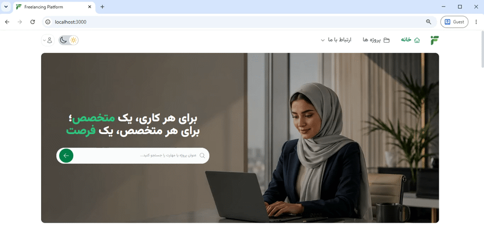
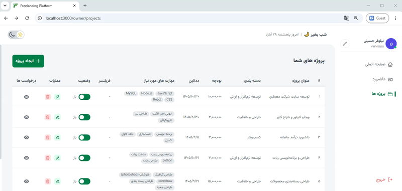
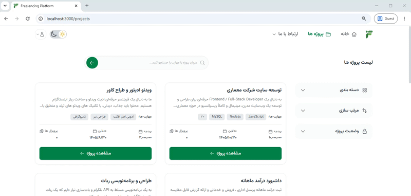

# Freelancing Platform

Developed the front end of a multi-role freelancing platform connecting employers and freelancers,
designed with a focus on clean component architecture, feature-based organization, and user workflows.

## Demo

**Home page and dark mode**



**Creating a project, changing proposal and project status**



**Search, filter and sending a proposal**



## Features

- Role-Based Dashboards: Engineered workflows for Admins (manage categories and user statuses), Employers
  (manage projects and proposal statuses), and Freelancers (submit and track proposals), with access management via protected routes.
- Project Search & Filtering: Built project search and dynamic filtering by category and status,
  with sorting, leveraging URL query strings and TanStack Query for efficient server-state management
  and shareable results.
- Authentication: Implemented phone-based authentication using OTP (One-Time Password) with client-side
  validation for user sign-in and registration, alongside silent token refresh via Axios interceptors
  to maintain user sessions.
- UI & Accessibility: Built responsive, accessible interfaces with smooth animations and light/dark mode,
  focused on a clean and consistent user experience.

## Tech Stack

- Frontend: React, Vite, TanStack Query, React Hook Form, Yup, Tailwind CSS, Axios, React Router, Framer Motion, Headless UI
- Backend: Node.js, Express
- Database: MongoDB

## Requirements

- Node.js
- MongoDB

## Backend

> The backend of this project was developed by Saheb Mohammadi, the instructor of the course I took. The frontend was developed by me.

<details>
<summary>Backend setup</summary>

```bash
cd backend
npm install
```

Copy `.env.example` to `.env` and fill in the values. Then run:

```bash
npm run dev
```

The backend runs on [http://localhost:5000](http://localhost:5000).

</details>

## Frontend

<details>
<summary>Frontend setup</summary>

```bash
cd frontend
npm install
```

Copy `.env.example` to `.env` and fill in the values. Then run:

```bash
npm run dev
```

Open [http://localhost:3000](http://localhost:3000) with your browser to see the result.

</details>
